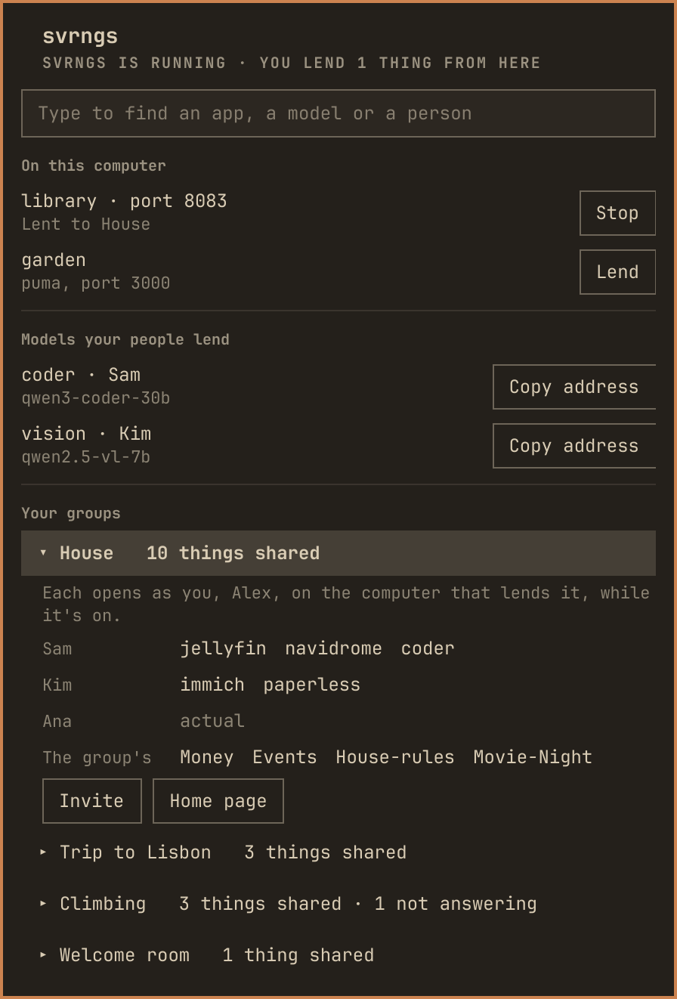

# svrngs.fam

Your [svrngs](https://github.com/alexsbryan/svrngs) groups, in the Omarchy bar.

Lend the app you're running, use your friends' models, and open what your
groups share, from one icon.

Nothing is lent until you say yes twice. Your svrngs key stays on your
computer, and the plugin sits idle while its panel is closed.



## Install

You need Omarchy. Download the two packages from the latest release, check
them, and install them:

```
mkdir -p ~/Downloads/svrngs && cd ~/Downloads/svrngs
U=https://github.com/alexsbryan/svrngs-fam/releases/download/v0.2.1
curl -fLO $U/SHA256SUMS -fLO $U/svrngs-bin-1.11.1-1-x86_64.pkg.tar.zst -fLO $U/svrngs-fam-0.2.1-1-any.pkg.tar.zst
sha256sum -c SHA256SUMS
sudo pacman -U svrngs-bin-1.11.1-1-x86_64.pkg.tar.zst svrngs-fam-0.2.1-1-any.pkg.tar.zst
```

Then, as yourself, start svrngs and put the icon in your bar:

```
/usr/share/svrngs/setup-user
/usr/share/svrngs-fam/setup-user
```

If you already run svrngs from its install line, setup moves that copy
aside rather than deleting it, and your groups carry on as before.

If you added only the plugin, from Omarchy's plugin marketplace, it needs
svrngs too: install the svrngs-bin package above, or use svrngs's own
install line. Beyond svrngs, it uses python, ss and wl-copy, which Omarchy
already has.

The trade-off for now: these packages don't update themselves, and they
aren't signed, though the svrngs inside is checked against the svrngs
release key when they're built. A new release is another download from
this page, until svrngs is in Omarchy's own package repository and arrives
with your system updates.

If you're new to svrngs, [start a group](https://github.com/alexsbryan/svrngs#start-a-group)
or ask a friend for their link. svrngs's guide explains
[lending](https://github.com/alexsbryan/svrngs/blob/main/docs/guide/lend.md)
and [models](https://github.com/alexsbryan/svrngs/blob/main/docs/guide/models.md).

## Remove

```
omarchy plugin disable svrngs.fam
rm ~/.config/omarchy/plugins/svrngs.fam
systemctl --user disable --now svrngs
sudo pacman -R svrngs-fam svrngs-bin
```

Your groups stay in `~/.svrngs`. If setup moved an older svrngs aside, it's
still in `~/.local/bin` with `.before-package` in its name.

If you added only the plugin, with `omarchy plugin add`, then
`omarchy plugin remove svrngs.fam` is all you need.

## Working on it

See [DEVELOPMENT.md](DEVELOPMENT.md).

MIT, © 2026 Alex Bryan. svrngs itself is
[AGPL-3.0](https://github.com/alexsbryan/svrngs/blob/main/LICENSE); this
plugin only talks to it, through its command and its local API.
