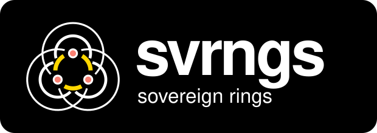

# svrngs.fam

Your [svrngs](https://github.com/alexsbryan/svrngs) groups, in the Omarchy bar.

Lend the app you're running, use your friends' models, and open what your
groups share, from one icon.

Nothing is lent until you say yes twice. A share reaches only the program
you approved: when another program answers on its port, svrngs refuses it,
and the panel offers Keep sharing it, which names the groups the share
goes to and asks again before it approves the one there now.
Copy address on a friend's model says what Play lets in before it turns
Play on: any program of yours on this computer can then use that model
with no key, until you press Stop. Your svrngs key stays on your computer.

While its panel is closed, the plugin reads svrngs only when the bar
starts and each time svrngs starts. If svrngs was updated but the old one
is still running, the plugin restarts it once to use the new one. It never
starts an svrngs older than 1.13.3, the first it works with: it offers Get
svrngs instead.


## Install

In Omarchy, add the plugin:

```
omarchy plugin add https://github.com/alexsbryan/svrngs-fam --enable
```

Click the people icon in your bar. If svrngs isn't on your computer yet,
or it's older than 1.13.3, press Get svrngs. If a friend sent you an invite
link, paste it first: svrngs then joins your friend's group right away,
before your home page opens, under the name the panel shows, which you can
change. That name starts as your account's full name, else its login name,
as svrngs reads it.

The plugin downloads svrngs and its installer from svrngs's latest
release, checks both against the svrngs release key, and installs svrngs
for you alone, with no password; an older svrngs in `~/.local/bin` is
replaced, and your groups are kept. It puts svrngs in `~/.local/bin`, runs
it as your user service (`systemctl --user`) whenever you log in, adds it
to your applications menu, and adds `~/.local/bin` to your shell's startup
file if your terminal doesn't look there yet. The invite link is used only
to join your friend's group. Your browser then opens your home page.

svrngs then takes its updates from svrngs's own page,
[group.svrnme.sh](https://group.svrnme.sh/), whatever page your invite
came from, and checks each against the svrngs release key before it
replaces itself. To have it update from another page, set `SVRNGS_FROM` to
that page's address in the environment your Omarchy session starts with,
before you press Get svrngs.

The plugin uses python, ss, wl-copy and gpg, which Omarchy already has.

svrngs and the plugin are also kept as Arch packages in
[svrngs-omarchy](https://github.com/alexsbryan/svrngs-omarchy), ready for
Omarchy's own package repository, which signs what it ships. That repository
doesn't carry them yet.

## Remove

```
omarchy plugin remove svrngs.fam
```

That removes the plugin and leaves svrngs, with your groups. What you lend,
and Play for a friend's model, stay on in svrngs until you stop them on your
home page; Play reaches whatever that friend lends under that name. Removing
svrngs from this computer doesn't take you out of your groups; `svrngs
leave <group>` does. To remove svrngs too, follow
[Remove svrngs](https://github.com/alexsbryan/svrngs-omarchy#remove-svrngs)
for the way you installed it.

## Working on it

See [DEVELOPMENT.md](DEVELOPMENT.md).

MIT, © 2026 Alex Bryan. svrngs itself is
[AGPL-3.0](https://github.com/alexsbryan/svrngs/blob/main/LICENSE); this
plugin only talks to it, through its command and its local API.
